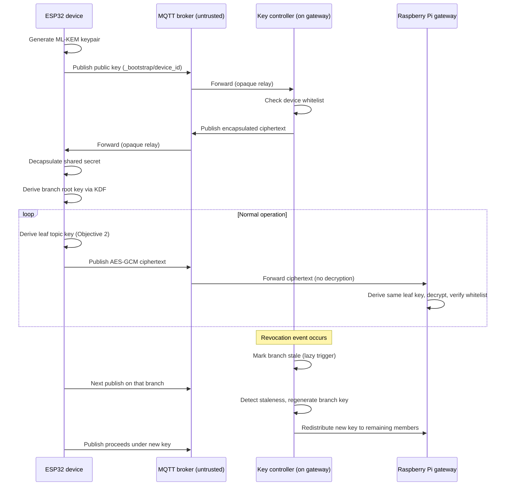
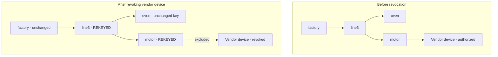
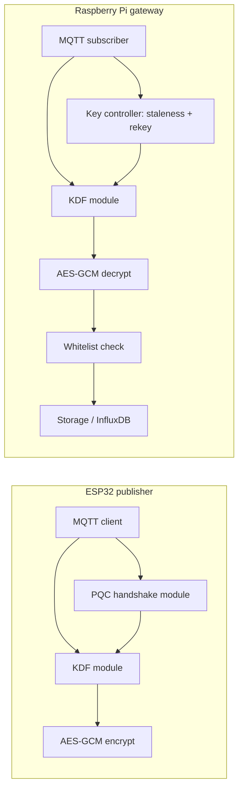

# Implementation Plan
## Post-Quantum Secured, Hierarchical Group End-to-End Encryption for Multi-Consumer Industrial Sensor Networks

This document turns the four project objectives into concrete build tasks, shows how they connect, and lays out the diagrams and build order for the implementation phase.

---

## 1. Objectives Recap

| # | Objective | One-line role |
|---|---|---|
| 1 | Extend one-to-one E2E to hierarchical group-wise E2E | The overall deliverable — everything else exists to make this real |
| 2 | Topic-hierarchical key derivation | The mechanism that makes one key cover a whole branch |
| 3 | Tree-based, lazily-triggered rekeying | The mechanism that makes revocation cheap and bounded |
| 4 | Post-quantum-secured key establishment | The mechanism that makes the handshake quantum-safe |

---

## 2. Objective-by-Objective Implementation Breakdown

### Objective 1 — Extend one-to-one E2E to hierarchical group-wise E2E
This is the umbrella objective, realized by wiring Objectives 2, 3, and 4 together around the baseline AES-GCM payload pipeline from Amirkhanova et al.

**Components to build:**
- Publisher module (ESP32): topic-key lookup → AES-256-GCM encrypt (adapted from the Paper 1 baseline)
- Subscriber/gateway module (Raspberry Pi): topic-key lookup (via Objective 2's derivation) → AES-256-GCM decrypt → whitelist check
- No crypto logic on the broker — it stays a pure, unmodified Mosquitto relay

**Tasks:**
1. Port/replicate Paper 1's AES-GCM pipeline on ESP32 (mbedTLS) as the payload baseline.
2. Replace the single pre-shared-key lookup with a call into the key-derivation module (`get_key(topic)` instead of a hardcoded key).
3. Support multiple simultaneous publishers on different leaf topics under one branch — no new logic needed beyond per-topic key lookup, but requires testing with 2+ ESP32 boards publishing concurrently.
4. Build a gateway-side multi-subscriber test harness (simulate a dashboard, a historian, and a vendor subscribing to overlapping branches of the topic tree).

**Validation:** publish under a branch, confirm every intended subscriber decrypts successfully, and confirm a subscriber scoped to a different branch cannot.

---

### Objective 2 — Topic-hierarchical key derivation
**Components to build:**
- KDF module: HKDF (HMAC-SHA256-based), implemented identically on ESP32 (mbedTLS HKDF, or hand-rolled HMAC-based KDF) and Raspberry Pi (Python `cryptography` library's HKDF)
- Topic-tree key cache: a local map from topic path → derived key, populated **lazily** (derive-on-demand, then cache) rather than precomputing the whole tree
- API: `get_key(topic_path, held_ancestor_key, held_ancestor_path)` — walks the remaining path segments, applying the KDF repeatedly

**Tasks:**
1. Define a canonical label encoding for each topic segment (deterministic byte encoding, e.g. UTF-8 bytes of the segment name) to feed into the KDF as the "info"/context parameter.
2. Implement `derive_child_key(parent_key, child_label) → child_key` using HKDF-Expand (parent key as PRK, child label as info).
3. Implement the path-walking derivation function: given a held key for some ancestor node, compute any descendant's key by applying step 2 repeatedly along the path.
4. Unit tests: confirm derived keys are deterministic and stable, and confirm ESP32 and Raspberry Pi implementations produce **identical** keys for the same path (cross-platform correctness is critical here).
5. Security check: confirm, by code review and a documented argument (not yet a formal proof), that there is no feasible path from a child key back to its parent.

**Validation:** cross-platform unit tests on identical inputs; a deliberate "attempt to derive upward" test that is expected to fail.

---

### Objective 3 — Tree-based, lazily-triggered rekeying
**Components to build:**
- A small **key-controller service**, co-located with the Raspberry Pi gateway (not the untrusted broker), tracking per-branch state: `{branch_path: {key_version, stale, last_rekey_time}}`
- Revocation API: `revoke(device_id, branch_path)` — removes the device from the branch's authorized list and sets `stale = True`
- Lazy trigger hook: inserted into the publish-handling path — before a message is accepted/forwarded on a branch, check its `stale` flag; if stale, regenerate and redistribute the branch's key to remaining authorized members **first**, then proceed
- Bounded staleness timer: a background check (e.g. every N minutes) that forces a rekey if a branch has been `stale` for longer than a configured maximum, even with no pending publish

**Tasks:**
1. Implement the key-controller service and its branch-state table.
2. Implement the revocation API.
3. Implement the lazy trigger hook in the publish path.
4. Implement the bounded staleness timer as a background task.
5. Confirm path-confinement: rekeying branch X must only regenerate X's key (and, by Objective 2's derivation, X's descendants) — siblings must remain untouched. This should fall out "for free" from the derivation design, but needs an explicit test.

**Validation:** simulate a revocation on an idle branch (confirm no rekey happens until the next publish or the staleness timeout); simulate a revocation on an active branch (confirm rekey completes before the next message is exposed); measure keys regenerated per revocation against tree depth.

---

### Objective 4 — Post-quantum-secured key establishment
**Components to build:**
- liboqs cross-compiled for ESP-IDF (ESP32 side) and available via liboqs-python or C bindings (Raspberry Pi side) — **flagged as the highest-risk integration task**
- ML-KEM handshake flow: device generates an ML-KEM keypair → publishes its public key → gateway/key-controller encapsulates against it and returns the ciphertext → device decapsulates → the resulting shared secret becomes the root key seed fed into Objective 2's derivation chain
- Device identity check integrated at this step, reusing Paper 1's whitelist/AAD approach

**Tasks:**
1. Cross-compile liboqs for the ESP-IDF toolchain.
2. Define the handshake message format (device public key, encapsulated ciphertext, device ID), carried as ordinary MQTT messages on a dedicated bootstrap topic (e.g. `_bootstrap/<device_id>`).
3. Implement the handshake state machine on both ends.
4. Feed the resulting shared secret into Objective 2's KDF as the root key for the device's authorized branch.
5. Benchmark handshake latency and message size against the classical ECDH baseline.

**Validation:** end-to-end handshake test (a fresh device boots, completes the handshake, and successfully derives and uses topic keys); latency/size benchmarking against the Amirkhanova baseline.

---

## 3. Suggested Build Order

Build from the most testable, hardware-independent component outward, deferring the riskiest integration (PQC on ESP32) as late as is safely possible:

| Phase | What gets built | Depends on |
|---|---|---|
| A | Objective 1 baseline alone — replicate Paper 1's single-publisher AES-GCM pipeline | — |
| B | Objective 2's KDF module, built and unit-tested as pure software (no hardware needed yet) | — |
| C | Integrate B into A — multi-topic-branch test with **manually provisioned** keys, no PQC yet | A, B |
| D | Objective 3's rekeying logic on top of C | C |
| E | Objective 4's PQC handshake, replacing manual key provisioning from C | B (feeds into it) |
| F | Full integration and the Chapter 3 evaluation plan (latency, rekeying cost, security validation, reliability) | A–E |

This ordering means the hardest, least certain piece (PQC on ESP32) is isolated to Phase E and can be de-risked independently, without blocking progress on the rest of the system.

---

## 4. High-Level Diagrams

### 4.1 Objective dependency flow
*(Rendered inline above — the PQC handshake bootstraps the key tree, the KDF derives every topic key from it, that combination is what makes Objective 1 real, and lazy rekeying operates on the same tree, looping back to the handshake only when something is revoked.)*

### 4.2 System architecture
*(Already built for the report — Figure 3.1.1: two ESP32 publishers under one topic branch, the untrusted broker relaying ciphertext only, and the Raspberry Pi gateway / vendor dashboard subscribing, with the PQC handshake shown as a separate bootstrap step.)*

### 4.3 End-to-end sequence diagram
Use this to trace a device's full lifecycle from boot to a revocation event. Paste into any Mermaid-capable viewer (GitHub, VS Code with the Mermaid extension):

### 4.4 Key tree state before/after a revocation

*(Illustrates path-confinement: only `line3` and `motor` are regenerated; `oven` and everything under `factory`'s other branches are untouched.)*

### 4.5 Software module diagram (per device role)

---

## 5. Risk Flags Carried Into This Phase
- **Highest risk**: liboqs integration into the ESP-IDF build (Objective 4, Phase E) — budget extra time here specifically.
- **Fallback if Phase E slips**: prototype the PQC handshake on the Raspberry Pi side first (gateway↔key-controller), and treat full ESP32-side PQC as a stretch goal — Phases A–D are independently completable and reportable without it.